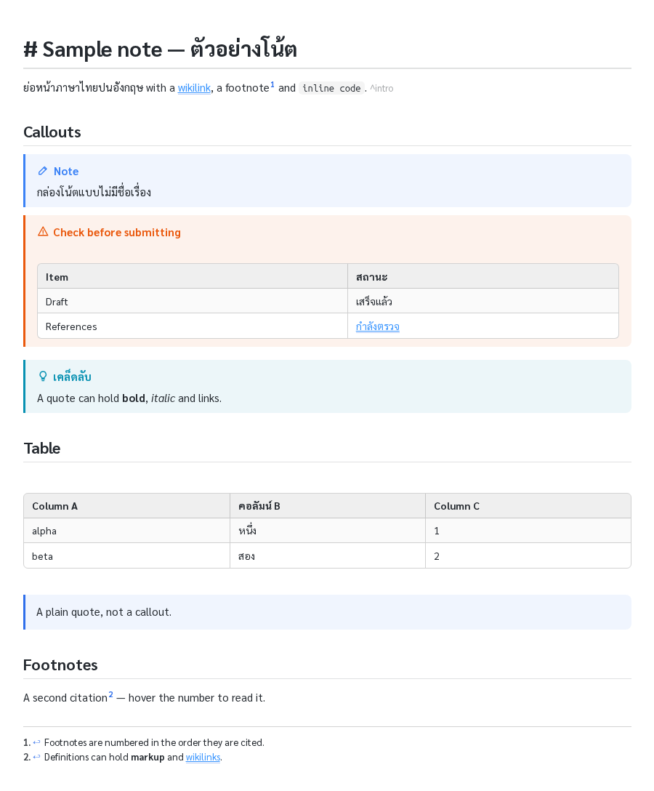

# md-live-preview-plus

A fork of [Markdown Live Preview Editor](https://github.com/t-shoot/md-live-preview-editor)
by t-shoot, for notes written the Obsidian way, with a bridge to Claude Code. It is
independent: it is affiliated with neither t-shoot nor Obsidian.

Everything upstream does still works: editing in the rendered preview, Mermaid and
draw.io diagrams, editable tables, CSS themes. See [README.upstream.md](README.upstream.md).
This fork adds:

- **Wikilinks**: `[[note]]`, `[[note#Heading]]` and `[[note#^block-id|label]]` render as links.
  - A click opens the note in Live Preview at the heading or block.
  - Notes are found by name anywhere in the workspace, as in Obsidian.
  - Links work in table cells, with `\|` or a bare `|` before the label.
  - **Hover** over a link to read its target in a card: a heading's section, or a block. The title of the card opens the note.
  - A link to a note that does not exist is shown faint.
- **Completion**:
  - `[[` offers the notes in the workspace.
  - `[[note#` offers that note's headings, and `[[note#^` its block ids.
  - `[^` offers the existing footnotes, plus *new footnote*.
- **Callouts**: `> [!note]`, `> [!warning] Title` and the other Obsidian types render as coloured cards with an icon.
  - `> [!type]-` starts folded and `> [!type]+` starts open. The chevron after the title folds or opens either.
- **Tables inside quotes and callouts** render as tables, even when the table follows a line of text directly.
- **Footnotes**: `[^1]` renders as a superscript number numbered by first citation.
  - Hover over the number to read the note. Click it to jump to the definition, and click `↩` to jump back.
  - **Insert Footnote** (`Ctrl+Alt+6`, or `Cmd+Alt+6` on macOS) adds the next number at the cursor and its definition at the end of the file.
- **Block ids** (`… ^ma-32`) are dimmed rather than shown at full strength.
- **HTML comments** (`<!-- … -->`) are tinted as notes to the writer.
- **Claude Code sees your selection**: the exact Markdown source, its line numbers and the file path. A webview's selection is otherwise invisible to VS Code and to Claude.
  - The file is saved when you select, so the line numbers match the file on disk.
  - A status bar item shows what Claude will get with your next prompt. Click it to stop sending.
  - A notice in Claude Code says what was sent.
- **A readable selection highlight**: the selection band no longer hides the text.
- **A Thai/English reading theme**: Sarabun is embedded, so no font needs installing.



**Get it from [Releases](../../releases), not from the VS Code Marketplace.** This fork is not
published there, on purpose: the Marketplace extension is t-shoot's own. It has its own id,
`local.markdown-live-preview-editor-claude`, so it never collides with upstream. It checks
GitHub once a day and tells you when a newer release is out.

## Install (Windows, macOS, Linux)

Download `md-live-preview-plus.zip` from [Releases](../../releases), unzip it, and run the
installer from that folder:

- **Windows:** `powershell -NoProfile -ExecutionPolicy Bypass -File .\install.ps1`
- **macOS / Linux:** `./install.sh` (needs `python3`)

The installer does three things:
1. It removes t-shoot's original extension if present, because both register the same editor. Then it installs the `.vsix`.
2. It copies the Claude Code hook to `~/.claude/hooks/`, or `%USERPROFILE%\.claude\hooks\` on Windows.
3. It registers the hook in Claude Code's `settings.json`, keeping your other settings. Running it twice is harmless.

Next:
1. Reload VS Code (*Developer: Reload Window*).
2. Start a new Claude Code session.
3. Open a `.md` file with *Open With → Markdown Live Preview*.

To check that the bridge works, select some text and ask Claude what you selected.

Only want the extension, without the Claude bridge? Install the `.vsix` on its own:
`code --install-extension markdown-live-preview-editor-claude-<version>.vsix`.

The reading theme `thai-readable.css` ships inside the `.vsix`. On first run it is added to
the **CSS Themes** view and switched on, unless you have already chosen another theme.
Later releases update it.

## Settings

| setting | default | what it does |
|---|---|---|
| `mdLivePreview.plus.shareSelectionWithClaude` | `true` | Writes the selection to `~/.claude/live-preview-selection.json`, only if `~/.claude` exists. |
| `mdLivePreview.plus.checkForUpdates` | `true` | Once a day, asks `api.github.com` for the latest release. |

The keybinding for **Insert Footnote** can be changed in *Keyboard Shortcuts*. Search for
`mdLivePreview.plus.insertFootnote`.

## How the Claude bridge works

1. The webview posts the CodeMirror selection to the extension host.
2. The host saves the file if it has unsaved changes, then writes `~/.claude/live-preview-selection.json`.
3. On every prompt, the hook (`plus/hooks/`) adds that selection to Claude's context and shows a one-line notice saying what it sent.

What the hook sends:
- **A new selection** is sent in full the first time a Claude session sees it.
- **The same selection on later prompts** gets a one-line reminder of its file and lines, so the conversation does not grow with every prompt.
- **A selection over 4,000 characters** is sent as its head and tail plus its line range, which Claude can read from the file.
- **Nothing** when the selection is empty or more than 30 minutes old.

The selection stops being sent when you:
- clear it, or click the status bar item;
- select text in an ordinary editor;
- close the preview.

The selection stays on your own machine. Claude receives it only when you send a prompt.

## Building from source

```
npm ci
npm run compile          # bundles, typechecks, builds the theme
npm test                 # unit tests (vitest)
npx playwright install chromium
npm run test:e2e         # the real webview in headless Chromium
npx vsce package         # → markdown-live-preview-editor-claude-<version>.vsix
```

`plus/release.sh` builds, tests, tags and publishes a GitHub release with the `.vsix` and
the installer zip. `node plus/render.js note.md` renders one of your own notes headlessly
and reports what the added features produced.

## Where the code is

The changes are kept apart so that upstream releases merge cleanly:

- **New files:**
  - `src/webview-editor/plus/` holds the editor side.
  - `src/editor/plus/` holds the extension host side.
  - `src/shared/plus*.ts` holds pure helpers shared by both.
  - `media/plus.css`, `plus/` (theme, fonts, hooks, installers, tools) and `test/e2e/plus.spec.ts`.
- **Upstream files** carry only small hooks, each marked `plus:` or `md-live-preview-plus`.
  - `src/webview-editor/plus/table.ts` replaces @lezer/markdown's GFM table parser with a copy that knows about wikilinks and quotes.

To take a new upstream release:
```
git fetch upstream && git merge upstream/main
```

## Licence

- **The code:** MIT, see `LICENSE`. It is t-shoot's licence, with this fork's copyright added for the changes.
- **AWS shapes (from upstream):** their own terms, see `THIRD-PARTY-NOTICES.md` and `LICENSE-SHAPES`.
- **Sarabun:** © 2018 The Sarabun Project Authors, SIL Open Font License 1.1, see `plus/fonts/OFL.txt`.
  - It is embedded in the theme.
  - The `.ttf` files in `plus/fonts/` are there if you want the font system-wide.
