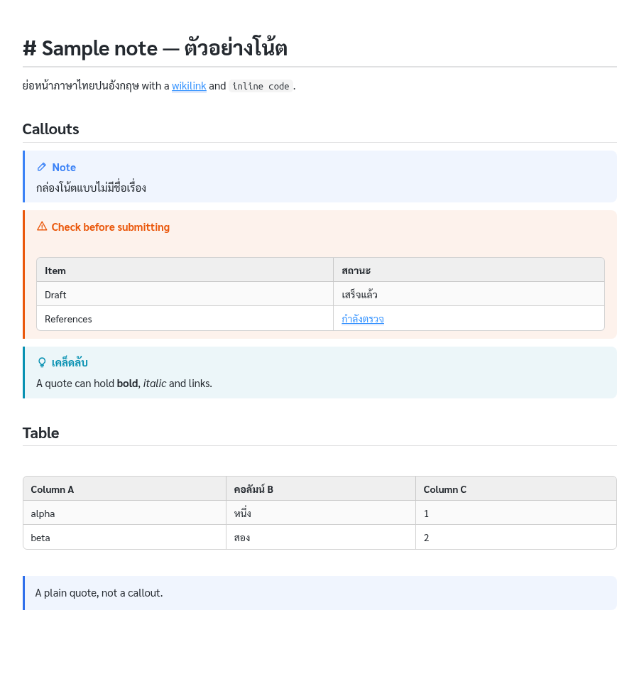

# md-live-preview-plus

A patched build of [Markdown Live Preview Editor](https://github.com/t-shoot/md-live-preview-editor)
(t-shoot) for notes written the Obsidian way, plus a bridge to Claude Code. It is an
independent patch: it is affiliated with neither t-shoot nor Obsidian. This package adds:

- **The selection, passed to Claude**: the exact markdown source, line numbers and file path.
- **Auto-save on select**: the file is saved when you select, so line numbers match the file on disk.
- **Wikilinks**: `[[note]]`, `[[note#Heading]]`, `[[note#^block|label]]` render as links and open the note in Live Preview at the anchor. Notes are found by name anywhere in the workspace, as in Obsidian.
- **Callouts**: `> [!note]`, `> [!danger] Title` and the other Obsidian types render as coloured cards with an icon (styled by `styles/thai-readable.css`).
- **Tables inside quotes and callouts** render as tables, including a table directly under a line of text, and a `|` inside `[[...]]` no longer splits a table cell.
- **A readable highlight**: the selection band becomes translucent instead of hiding the text.

It is a patched copy of version 0.4.0 (MIT licence, notice kept). The patched copy
has its own id, `local.markdown-live-preview-editor-claude`, so a marketplace update
can never overwrite it.



**Get it from [Releases](../../releases)**, not from the VS Code Marketplace. This patched copy is
not published there, on purpose: the Marketplace extension is t-shoot's own.

## Install (Windows, macOS, Linux)

1. **Remove the original extension.** In Extensions, uninstall *Markdown Live Preview
   Editor* by t-shoot. Both register the same editor and commands.
2. **Install the patched copy:**
   ```
   code --install-extension markdown-live-preview-editor-claude-0.4.0.vsix   # from the Release assets
   ```
   Or use Extensions → `...` → *Install from VSIX...*
3. **Install the hook.** Copy it into `~/.claude/hooks/`, which is
   `%USERPROFILE%\.claude\hooks\` on Windows.
   - Windows: `hooks/live-preview-selection.ps1`
   - macOS/Linux: `hooks/live-preview-selection.py` (needs `python3`)
4. **Register the hook** in `~/.claude/settings.json`. Merge it into any `hooks`
   already there; don't replace them.

   **Windows:**
   ```json
   {
     "hooks": {
       "UserPromptSubmit": [
         { "hooks": [ { "type": "command", "shell": "powershell",
             "command": "powershell -NoProfile -ExecutionPolicy Bypass -File \"$env:USERPROFILE\\.claude\\hooks\\live-preview-selection.ps1\"",
             "timeout": 5 } ] }
       ]
     }
   }
   ```
   **macOS/Linux:**
   ```json
   {
     "hooks": {
       "UserPromptSubmit": [
         { "hooks": [ { "type": "command",
             "command": "python3 ~/.claude/hooks/live-preview-selection.py",
             "timeout": 5 } ] }
       ]
     }
   }
   ```
5. Reload VS Code, open a `.md` file with *Open With → Markdown Live Preview*, select
   some text, and ask Claude what you selected.

## Font (optional)

`styles/thai-readable.css` is a reading style for Thai and English. It embeds
Sarabun in four styles (Regular, Bold, Italic, Bold Italic), so no font needs to be
installed. Sarabun is © 2018 The Sarabun Project Authors and is used under the SIL
Open Font License 1.1 (`fonts/OFL.txt`). The `.ttf` files in `fonts/` are included
for anyone who wants to install the font system-wide as well.

To enable the style:
1. Open the **CSS Themes** view in the sidebar.
2. Add `thai-readable.css`, or copy it into the extension's styles folder:
   - Linux: `~/.config/Code/User/globalStorage/local.markdown-live-preview-editor-claude/styles/`
   - Windows: `%APPDATA%\Code\User\globalStorage\local.markdown-live-preview-editor-claude\styles\`
3. Enable it there.

To change the theme, edit `styles/src/thai-readable.theme.css` and run
`python3 styles/build_style.py --install`. The script embeds the fonts and installs
the result on this machine. The preview image is `styles/preview/sample.png`, rendered from `test/sample.md`.

The patched extension also allows embedded fonts in the editor's security policy.
Without that, the original extension would block them.

## How it works

- The webview reads the CodeMirror selection and posts it to the extension host.
- The extension host saves the file if it is dirty, then writes
  `~/.claude/live-preview-selection.json`.
- On every prompt, the hook prints that file as context. It only does so when the
  selection is non-empty and less than 30 minutes old.

The selection is saved only on your own machine, and Claude receives it only when you send a prompt.

## When upstream releases a new version

You don't have to follow upstream: version 0.4.0 keeps working. To move to a newer
release:
```
node patch.js <unpacked-new-extension-dir> --rename
cd <that dir> && npx @vscode/vsce package --no-dependencies --allow-missing-repository
```
`patch.js` anchors each edit on a string that must occur exactly once. If upstream
renamed something, the script stops with an error instead of producing a broken
build. In that case the anchors in `patch.js` must be updated.

## Notes

- Selecting text saves the file.
- The Windows hook has not been tested on Windows yet.

## Building it yourself

```
curl -L -o upstream/t-shoot.markdown-live-preview-editor-0.4.0.vsix \
  https://marketplace.visualstudio.com/_apis/public/gallery/publishers/t-shoot/vsextensions/markdown-live-preview-editor/0.4.0/vspackage
./build.sh
python3 styles/build_style.py
```

## Licence

- **This repository's own code:** MIT, see `LICENSE`.
- **Markdown Live Preview Editor (t-shoot):** MIT, see `LICENSE-upstream.txt`. The built `.vsix` carries the upstream notices.
- **Sarabun:** SIL Open Font License 1.1, see `fonts/OFL.txt`.

This is an independent patch, affiliated with neither t-shoot nor Obsidian.

